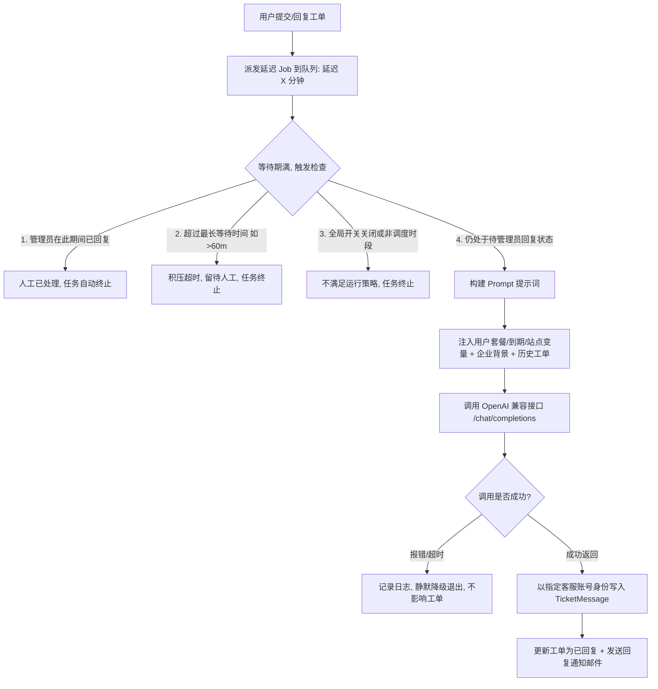

# V2Board 智能 AI 客服工单系统设计与落地实施方案

> **文件归属**：`docs/v2board_ai_service_implementation_plan.md`  
> **创建时间**：2026-10-14  
> **设计状态**：已完成技术调研与架构设计，已封存待启动实施  
> **核心原则**：KISS（简洁至上）、零数据库改动（0 Migration）、对现有正常工单 0 破坏、人工优先与互斥避让

---

## 一、 功能概述与业务闭环

本功能为 V2Board 的工单系统（Ticket）引入基于大语言模型（LLM）的智能客服自动回复机制。

### 1. 业务痛点解决
* **非工作时段/离线响应**：站长或人工客服离线时，用户工单不会长时间挂起，AI 及时接管解答。
* **防止秒回废话**：引入“等待时间缓冲机制（如 5 分钟）”，给人工客服保留优先响应权；若人工在时间内回复，AI 自动退出，杜绝打扰。
* **防队列积压误答**：设置“最长等待时间（如 60 分钟）”，超过设定时间的旧工单不再触发 AI，防止队列卡顿后突然“挖坟”回复引发尴尬。
* **知识继承与风格统一**：支持注入“企业背景（业务规则、故障排查、常见政策）”与“历史工单检索（RAG Few-shot）”，让 AI 自动学习站长过去的回复习惯。

### 2. 状态与互斥流程图



---

## 二、 完整配置项字典 (存储于 config/v2board.php)

V2Board 的配置机制直接存写于 `config/v2board.php`，保存时触发 `Artisan::call('config:cache')`，**完全不需要新增或更改数据库表结构**。

| 配置 Key | 类型 | 默认值 | 详细说明 |
| :--- | :--- | :--- | :--- |
| `ai_reply_enable` | bool/int | `0` | AI 自动回复全局总开关（0=关，1=开） |
| `ai_provider` | string | `'OpenAI'` | 模型服务商，支持 OpenAI 兼容格式 |
| `ai_api_url` | string | `'https://api.openai.com/v1'` | API Base URL（如对接 DeepSeek 填 `https://api.deepseek.com/v1`） |
| `ai_api_key` | string | `''` | 接口鉴权密钥 API Key |
| `ai_model` | string | `'gpt-4o-mini'` | 调用的模型名称（如 `deepseek-chat`, `gpt-4o-mini`） |
| `ai_temperature` | float | `0.3` | 温度参数（0.2~0.5 最佳，客服场景强调稳定不胡说） |
| `ai_max_tokens` | int | `1024` | 单次回复的最大 Token 数量 |
| `ai_timeout` | int | `60` | 请求超时时间（秒，建议 5~75 秒） |
| `ai_stream_enable`| bool/int | `0` | 是否开启流式请求（SSE）调用模型 |
| `ai_schedule_mode`| string | `'all'` | 调度模式（`all`: 全时段开启，`night`: 仅非工作时段/夜间开启） |
| `ai_wait_time` | int | `5` | 等待时间（分钟），用户发消息后管理员未回复则 AI 接管；0 为立即回复 |
| `ai_max_wait_time`| int | `60` | 最长等待时间（分钟），超时不再调用 AI；0 为不限制 |
| `ai_user_id` | int | `0` | AI 回复身份的用户 ID（必须为管理员或客服账号 UID） |
| `ai_email_notify` | bool/int | `0` | AI 回复后是否向用户发送工单邮件提醒 |
| `ai_history_num` | int | `10` | 参考历史工单条数，按更新时间倒序检索，0 为不参考 |
| `ai_history_tokens`| int | `3000` | 历史工单注入的最大 Token 上限，防止超大上下文 |
| `ai_history_days` | int | `180` | 检索历史工单的有效天数（只查最近 N 天内更新的工单） |
| `ai_agent_name` | string | `'AI 客服'` | 客服昵称，对应提示词变量 `{agent_name}` |
| `ai_company_bg` | string | `''` | 企业背景介绍，对应提示词变量 `{company_background}` |
| `ai_system_prompt`| string | `''` | 核心系统提示词，支持动态变量插值 |

### 动态 Prompt 变量插值表
* `{agent_name}`：客服名称（如“官方智能助理”）
* `{app_name}`：站点名称
* `{app_url}`：站点前端访问地址
* `{current_time}`：当前精确时间（例：`2026-10-14 17:30:00`）
* `{current_date}`：当前日期（例：`2026-10-14`）
* `{weekday}`：当前星期（例：`星期三`）
* `{company_background}`：后台填写的企业背景/业务排障说明
* `{user_email}`：当前提问用户的邮箱
* `{plan_name}`：当前用户订阅的套餐名称（若无套餐提示“无有效套餐”）
* `{expired_at}`：当前用户套餐到期时间（帮助 AI 识别“是否因过期断网”）

---

## 三、 技术架构与代码落地细节

### 1. 前端模块（React 19 + Ant Design 6）
* **修改文件**：`v2board-admin-main/src/pages/config/SystemConfigPage.tsx`
* **状态集成**：`v2board-admin-main/src/stores/configManage.ts`
* **UI 交互规范**：
  * 在 Tabs 增加 `{ key: 'ai_service', label: 'AI客服' }`。
  * 当“AI 自动回复”Switch 为开启状态时，展开详细调度与参数配置卡片。
  * 保持与现有的 `ConfigItem`、输入框防抖自动保存、暗黑/明亮主题样式 100% 统一。

### 2. 后端核心模块（Laravel）

#### A. 核心服务：`app/Services/AiService.php`
* **职责**：
  1. 读取配置，校验开关与配置合法性。
  2. 格式化 System Prompt，注入环境变量与用户信息。
  3. 历史工单召回（根据用户最新问题，在最近 `ai_history_days` 天内的已完结工单中检索上下文，截断至 `ai_history_tokens`）。
  4. 组装 messages 数组（System + Few-shot 历史参考 + 当前工单上下文）。
  5. 调用 OpenAI 兼容接口，带超时保护与异常捕获。

#### B. 异步调度任务：`app/Jobs/TicketAiReplyJob.php`
* **执行逻辑**：
  ```php
  public function handle()
  {
      $ticket = Ticket::find($this->ticketId);
      if (!$ticket || $ticket->status !== 0) return; // 工单已关闭则退出
      
      // 1. 检查最新一条发言人
      $lastMsg = TicketMessage::where('ticket_id', $ticket->id)->orderBy('id', 'desc')->first();
      if (!$lastMsg || $lastMsg->user_id !== $ticket->user_id) {
          // 证明管理员在此期间已经回复了，AI 立即退避！
          return;
      }
      
      // 2. 检查等待时长与超时上限
      $elapsedMinutes = now()->diffInMinutes($lastMsg->created_at);
      $maxWait = (int)config('v2board.ai_max_wait_time', 60);
      if ($maxWait > 0 && $elapsedMinutes > $maxWait) {
          return; // 超过最长等待时间，堆积放弃，留给人工
      }
      
      // 3. 调用 AiService 获取回答
      $aiService = new AiService();
      $replyText = $aiService->generateReply($ticket, $lastMsg);
      if (!$replyText) return;
      
      // 4. 调用原生成熟方法回复工单（0副作用，100%兼容系统原生流）
      $ticketService = new TicketService();
      $aiUserId = (int)config('v2board.ai_user_id', 1);
      $ticketService->replyByAdmin($ticket->id, $replyText, $aiUserId);
  }
  ```

#### C. 工单触发挂载点：
* 在 `app/Http/Controllers/V1/User/TicketController.php` 的工单创建与工单回复方法中：
  ```php
  if (config('v2board.ai_reply_enable')) {
      $waitTime = (int)config('v2board.ai_wait_time', 5);
      TicketAiReplyJob::dispatch($ticket->id)->delay(now()->addMinutes($waitTime));
  }
  ```

---

## 四、 实施任务清单（Task List，开搞时按序执行）

- [ ] **任务 1**：后端配置项注入与持久化
  - 在 `config/v2board.php` 中补充默认 `ai_*` 配置项。
  - 在 `Admin/ConfigController.php` 的保存/读取白名单中注册 AI 配置字段。
- [ ] **任务 2**：开发 `App\Services\AiService`
  - 实现标准 OpenAI 兼容 `/v1/chat/completions` 请求驱动（支持 DeepSeek / OpenAI）。
  - 实现 Prompt 动态占位符插值。
  - 实现工单历史对话与历史工单（RAG Few-shot）截断组装。
- [ ] **任务 3**：开发 `App\Jobs\TicketAiReplyJob`
  - 实现人工回复检查、互斥退避、最长等待超时跳过与防穿透逻辑。
  - 接入 `TicketService::replyByAdmin`。
- [ ] **任务 4**：挂载工单触发器
  - 在 `User/TicketController.php` 的用户提单/回复处分发延时任务。
- [ ] **任务 5**：前端 React 管理界面实现
  - 在 `v2board-admin-main/src/pages/config/SystemConfigPage.tsx` 中编写 `AI客服` Tab 界面。
  - 接入折叠、联动开关、密码框掩码与数值输入。
  - 前端编译验证。
- [ ] **任务 6**：端到端闭环验证
  - 测试 1：用户发工单，管理员 5 分钟内不理睬，AI 自动以官方账号身份回复，邮件正常到达。
  - 测试 2：用户发工单，管理员 2 分钟内手动回复，5 分钟后 AI 自动取消退避，不发生重复抢答。
  - 测试 3：断网/API Key 无效情况下，工单系统不报错，静默降级为纯人工模式。

---

## 五、 后续唤醒口令

当以后需要动手编码实现时，只需在对话框中发送以下指令即可立即唤醒并开始：

> **“请读取 `docs/v2board_ai_service_implementation_plan.md`，按照里面的设计和任务清单直接开始实施 AI 客服功能。”**
